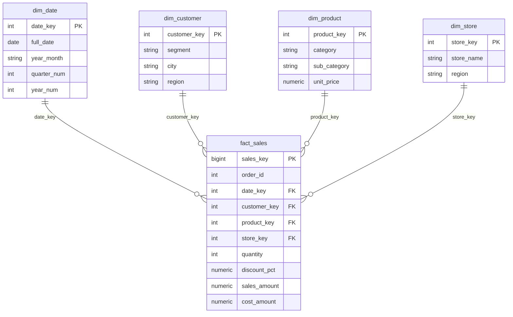

# SQL Week 5 Mini Project — Dimensional Model + Window Function Report + CTE MoM Growth

DataGrokr PLP · SQL Week 5 (Intermediate + Advanced) · PostgreSQL 14+

A retail sales **star schema** (1 fact + 4 dimensions) with reports built on
**window functions**, **CTE-based month-over-month growth**, **ROLLUP / CUBE / GROUPING SETS**,
**views / materialized views** and an **EXPLAIN** optimisation demo.

## Star schema



**Grain:** one row per product line on a sales order. **Measures:** `quantity`, `sales_amount`, `cost_amount`.
Design choices: surrogate keys, `YYYYMMDD` date key, FK indexes, CHECK constraints, descriptive attributes denormalised into dimensions (star, not snowflake).

## Repo layout

| File | What it contains |
|---|---|
| `sql/01_schema.sql` | Schema `retail`, 4 dimensions, fact table, constraints, indexes |
| `sql/02_seed_data.sql` | Reproducible sample data (`setseed`): 731 dates, 120 customers, 24 products, 6 stores, ~5,000 sales lines |
| `sql/03_window_functions.sql` | 10 window queries: RANK/DENSE_RANK/ROW_NUMBER, NTILE, LAG/LEAD, running total, moving average, FIRST/LAST_VALUE, PERCENT_RANK, CUME_DIST |
| `sql/04_cte_mom_growth.sql` | Chained-CTE MoM growth (overall, by category, by region), YoY, best/worst months, recursive month calendar |
| `sql/05_rollup_cube_grouping_sets.sql` | ROLLUP, CUBE, GROUPING SETS, `GROUPING()` |
| `sql/06_views_and_explain.sql` | View, materialized view, EXPLAIN ANALYZE before/after index |
| `run_all.sh` | Runs everything in order, saves results to `output/` |
| `sample_output/` | Results from my own run |

## How to run

```bash
# 1. Install PostgreSQL 14+ (psql must work), then:
git clone <your-repo-url> && cd sql-week5-dimensional-report
./run_all.sh            # creates DB week5_dw, runs all scripts, writes ./output/*.txt

# or interactively
createdb week5_dw
psql -d week5_dw -f sql/01_schema.sql -f sql/02_seed_data.sql
psql -d week5_dw -f sql/04_cte_mom_growth.sql
```

## Step-by-step: how to build this project yourself

1. **Pick a business process** (retail sales) and the **grain** of the fact table.
2. **Identify dimensions** (who/what/where/when) and **measures** (numbers you sum). Draw the star.
3. **Write DDL** — dimensions first, then the fact with foreign keys, CHECKs, and indexes on FK columns.
4. **Load data** — a date dimension with `generate_series`, small dimensions by hand, fact rows generated randomly with a fixed seed.
5. **Verify the load** — row counts, no orphan FKs, `SUM(sales_amount)` sanity check.
6. **Window function report** — rank products/customers/stores, then add LAG/LEAD, running totals and moving averages with explicit frames.
7. **CTE MoM growth** — CTE 1 aggregates by month, CTE 2 adds `LAG(revenue)`, final SELECT computes `(rev - prev) / NULLIF(prev,0) * 100`.
8. **Multi-level reports** — ROLLUP for subtotals, CUBE for all combos, GROUPING SETS for custom ones.
9. **Views + EXPLAIN** — wrap the star join in a view, materialise the MoM report, compare plans with and without an index.
10. **Document and push** — README, sample output, commit, push to GitHub.

## Key concepts demonstrated (good for the weekly test)

- `RANK` leaves gaps after ties, `DENSE_RANK` does not, `ROW_NUMBER` never ties.
- You can't filter on a window function in `WHERE` — wrap it in a CTE/subquery.
- `LAST_VALUE` needs `ROWS BETWEEN UNBOUNDED PRECEDING AND UNBOUNDED FOLLOWING`; the default frame stops at the current row.
- `NULLIF(prev,0)` avoids divide-by-zero in growth %; first month's MoM is NULL by design.
- `GROUPING()` distinguishes a real NULL from a ROLLUP subtotal NULL.
- Materialized views store data (fast, can be stale); standard views are just saved queries.
